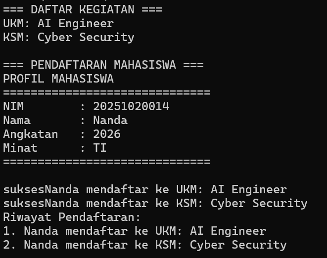
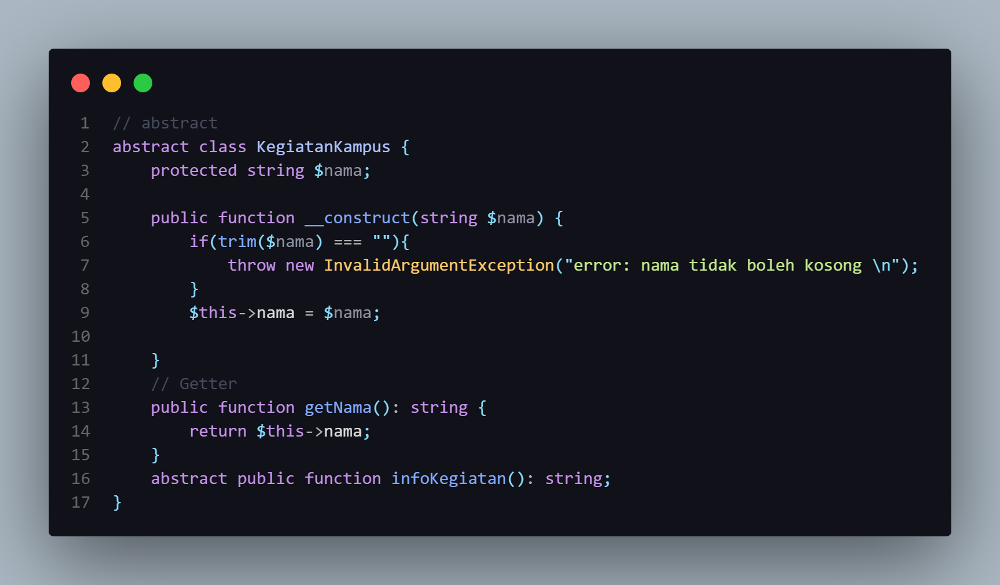
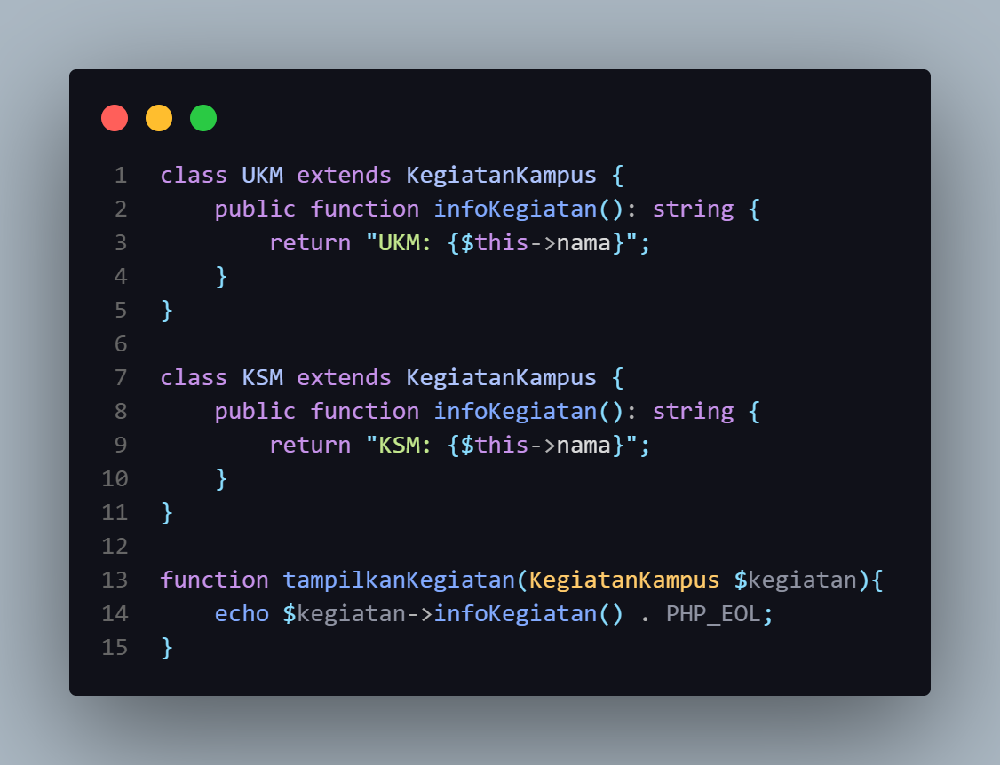
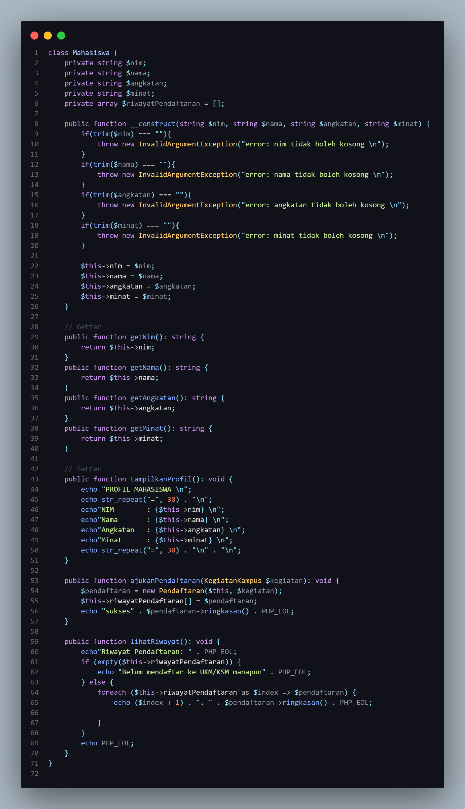
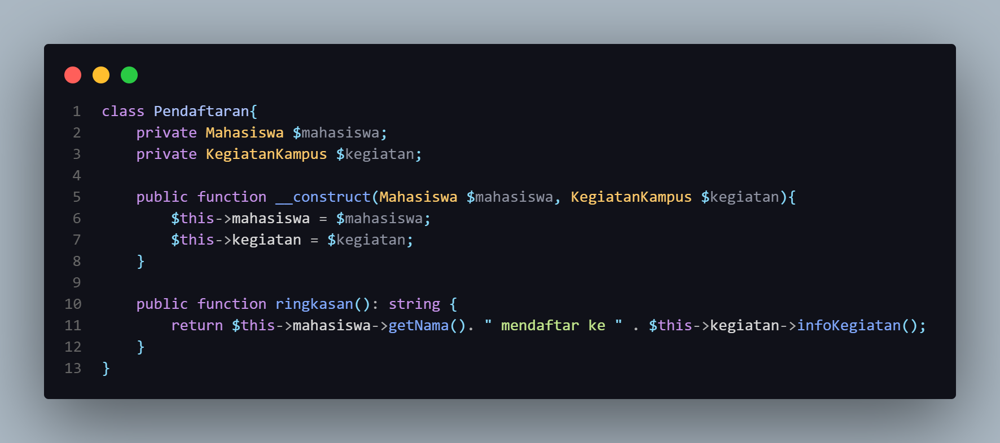
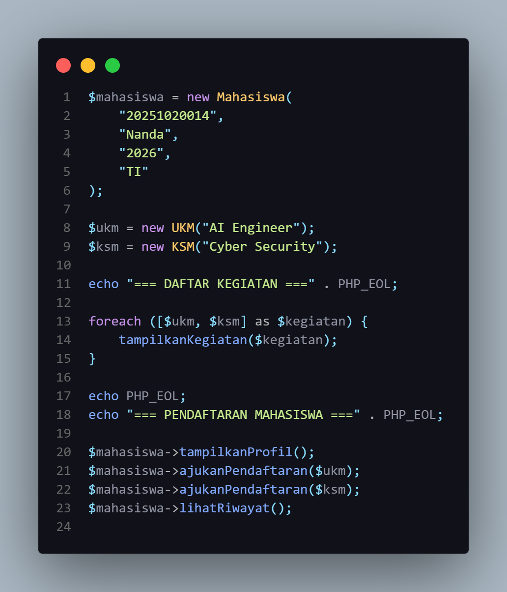

# Mini Application OOP: Pendaftaran UKM dan KSM

## 1. Gambaran singkat

Program ini merupakan pengembangan dari kasus `Mahasiswa` pada tugas sebelumnya. Kasus yang digunakan adalah pendaftaran kegiatan mahasiswa, khususnya UKM (Unit Kegiatan Mahasiswa) dan KSM (Kelompok Studi Mahasiswa).

Program dapat menampilkan daftar kegiatan, menampilkan profil mahasiswa, menerima pendaftaran, dan menampilkan riwayat pendaftaran mahasiswa.

Implementasi ini dibuat berdasarkan materi Pertemuan 5 PBO tentang Advanced OOP. Konsep yang digunakan adalah abstract class, inheritance, overriding, polymorphism, encapsulation, dan composition.

## 2. Masalah yang ingin diselesaikan

Pada tugas sebelumnya, riwayat pendaftaran mahasiswa masih disimpan sebagai teks nama UKM. Cara tersebut memang cukup untuk contoh sederhana, tetapi informasi pendaftaran menjadi terbatas.

Pada pengembangan ini, kegiatan kampus dipisahkan menjadi beberapa class. Data mahasiswa dan kegiatan juga dihubungkan melalui class `Pendaftaran`, sehingga hubungan antarobjek lebih jelas.

## 3. Class yang digunakan

| Class | Peran |
| --- | --- |
| `Mahasiswa` | Menyimpan data mahasiswa dan riwayat pendaftaran. |
| `KegiatanKampus` | Abstract class yang menjadi dasar semua kegiatan kampus. |
| `UKM` | Subclass untuk jenis kegiatan UKM. |
| `KSM` | Subclass untuk jenis kegiatan KSM. |
| `Pendaftaran` | Menghubungkan mahasiswa dengan kegiatan yang dipilih. |

Gambaran relasinya:

```text
KegiatanKampus
├── UKM
└── KSM

Pendaftaran
├── Mahasiswa
└── KegiatanKampus
```

## 4. Penerapan konsep OOP

### Abstract class

`KegiatanKampus` dibuat sebagai abstract class karena class ini hanya menjadi konsep umum. Semua kegiatan memiliki nama, tetapi cara menampilkan informasinya dapat berbeda.

```php
abstract class KegiatanKampus
{
    protected string $nama;

    abstract public function infoKegiatan(): string;
}
```

Object langsung dari `KegiatanKampus` tidak dibuat. Object yang dibuat adalah class turunannya, yaitu `UKM` dan `KSM`.

### Inheritance

`UKM` dan `KSM` mewarisi `KegiatanKampus` menggunakan kata kunci `extends`.

```php
class UKM extends KegiatanKampus
{
    // ...
}

class KSM extends KegiatanKampus
{
    // ...
}
```

Hubungan ini sesuai dengan konsep inheritance karena UKM dan KSM merupakan jenis dari kegiatan kampus.

### Overriding

Parent class memiliki method abstract `infoKegiatan()`. Method tersebut kemudian dibuat ulang pada `UKM` dan `KSM`.

```php
class UKM extends KegiatanKampus
{
    public function infoKegiatan(): string
    {
        return "UKM: {$this->nama}";
    }
}
```

```php
class KSM extends KegiatanKampus
{
    public function infoKegiatan(): string
    {
        return "KSM: {$this->nama}";
    }
}
```

Nama method-nya sama, tetapi hasil informasinya menyesuaikan jenis kegiatan.

### Polymorphism

Polymorphism diterapkan melalui fungsi berikut:

```php
function tampilkanKegiatan(KegiatanKampus $kegiatan)
{
    echo $kegiatan->infoKegiatan() . PHP_EOL;
}
```

Fungsi tersebut menerima tipe umum `KegiatanKampus`, tetapi dapat digunakan untuk object `UKM` maupun `KSM`. Kode pemanggil tidak perlu membuat `if` berdasarkan nama class.

Contohnya:

```php
foreach ([$ukm, $ksm] as $kegiatan) {
    tampilkanKegiatan($kegiatan);
}
```

Ketika object `UKM` dikirim, method milik `UKM` yang dijalankan. Ketika object `KSM` dikirim, method milik `KSM` yang dijalankan.

### Encapsulation

Data pada class `Mahasiswa` dibuat `private`, sehingga tidak dapat diakses langsung dari luar class. Penggunaan data dilakukan melalui method seperti `getNama()`, `tampilkanProfil()`, dan `lihatRiwayat()`.

Constructor juga melakukan validasi agar NIM, nama, angkatan, dan minat tidak boleh kosong.

### Composition

Class `Pendaftaran` memiliki dua object, yaitu `Mahasiswa` dan `KegiatanKampus`.

```php
class Pendaftaran
{
    private Mahasiswa $mahasiswa;
    private KegiatanKampus $kegiatan;
}
```

Relasi ini disebut composition atau hubungan `has-a`. Satu object `Pendaftaran` memiliki data mahasiswa dan kegiatan yang dipilih.

Riwayat pendaftaran pada `Mahasiswa` juga menyimpan object `Pendaftaran`, bukan hanya string nama kegiatan.

## 5. Alur program

1. Program membuat object mahasiswa bernama Nanda.
2. Program membuat object `UKM` dengan nama AI Engineer.
3. Program membuat object `KSM` dengan nama Cyber Security.
4. Kedua kegiatan ditampilkan melalui fungsi `tampilkanKegiatan()`.
5. Mahasiswa mengajukan pendaftaran ke UKM dan KSM.
6. Setiap pendaftaran disimpan sebagai object `Pendaftaran`.
7. Riwayat pendaftaran ditampilkan melalui method `lihatRiwayat()`.

## 6. Cara menjalankan program

Pastikan PHP sudah terpasang, kemudian jalankan perintah berikut dari folder project:

```bash
php index.php
```

Pemeriksaan sintaks dapat dilakukan dengan perintah:

```bash
php -l index.php
```

## 7. Hasil program

Program menampilkan daftar kegiatan, profil mahasiswa, hasil pendaftaran, dan riwayat pendaftaran.



Pada output tersebut terlihat bahwa mahasiswa Nanda berhasil mendaftar ke UKM AI Engineer dan KSM Cyber Security. Kedua pendaftaran kemudian muncul dalam riwayat.

## 8. Dokumentasi kode

### Abstract class `KegiatanKampus`



### Subclass dan polymorphism



### Class `Mahasiswa`



### Class `Pendaftaran`



### Pengujian program



## 9. Kesesuaian dengan tugas halaman 20

| Ketentuan tugas | Penerapan pada program |
| --- | --- |
| Minimal 4 kandidat class | Terdapat `Mahasiswa`, `KegiatanKampus`, `UKM`, `KSM`, dan `Pendaftaran`. |
| Menentukan relasi class | Menggunakan inheritance dan composition. |
| Abstract class atau interface | Menggunakan abstract class `KegiatanKampus`. |
| Minimal 1 overriding | `infoKegiatan()` dibuat ulang pada `UKM` dan `KSM`. |
| Minimal 1 polymorphism | Fungsi `tampilkanKegiatan()` menerima `UKM` dan `KSM` melalui tipe parent. |
| Menjalankan program dan menyimpan screenshot | Output program didokumentasikan pada `output.png`. |
| Menulis README | Penjelasan masalah, desain, dan alasan pemilihan relasi ada di file ini. |

## 10. Kesimpulan

Penggunaan abstract class membuat struktur kegiatan kampus menjadi lebih teratur. `UKM` dan `KSM` dapat memiliki perilaku yang berbeda melalui overriding, tetapi tetap dapat diproses oleh fungsi yang sama melalui polymorphism.

Class `Pendaftaran` membuat hubungan antara mahasiswa dan kegiatan menjadi lebih jelas. Dengan desain ini, jenis kegiatan baru masih dapat ditambahkan tanpa harus mengubah fungsi `tampilkanKegiatan()`.

Program ini masih sederhana dan belum menggunakan database atau Laravel, sesuai batasan tugas. Fokusnya adalah menerapkan konsep Advanced OOP pada masalah yang dekat dengan lingkungan kampus.
